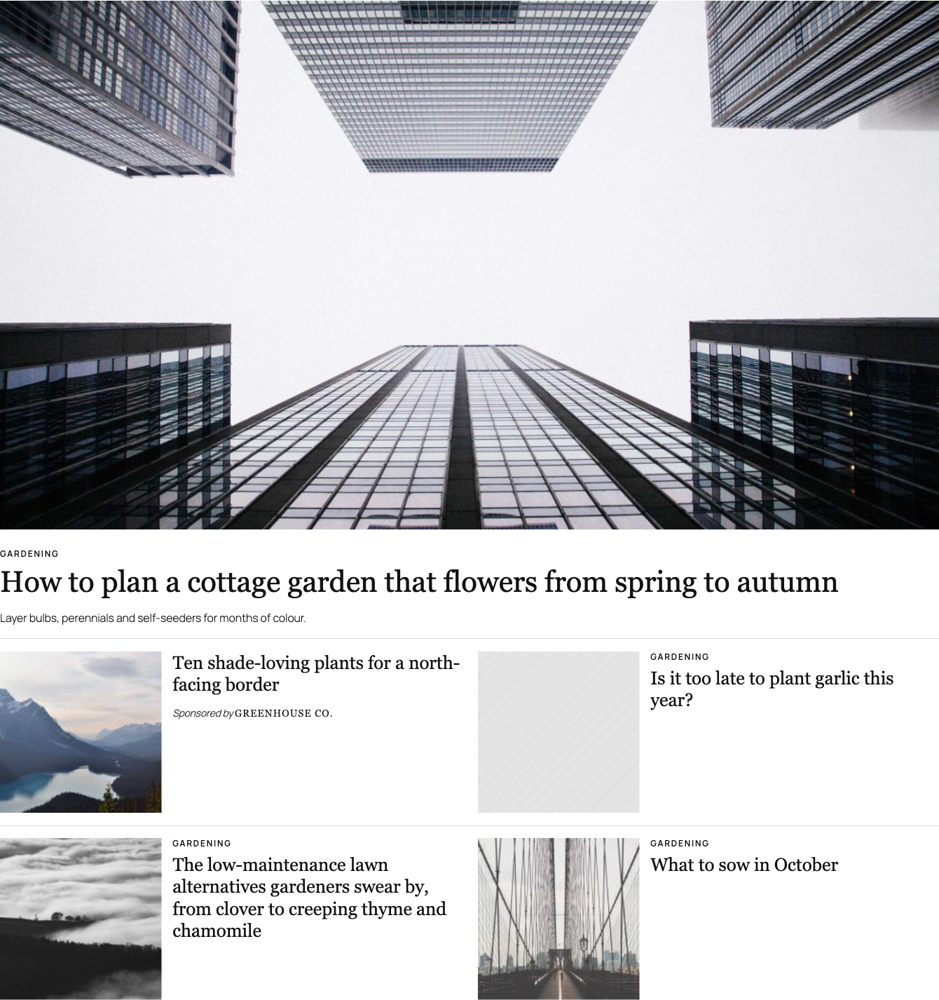
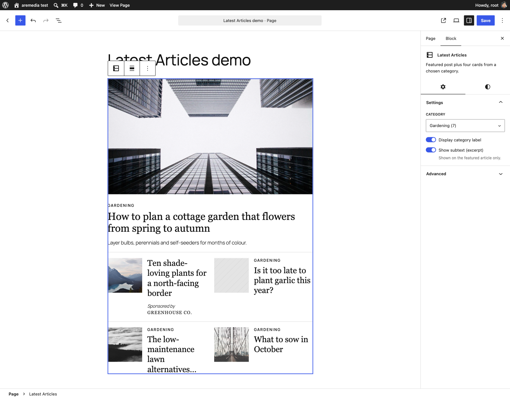
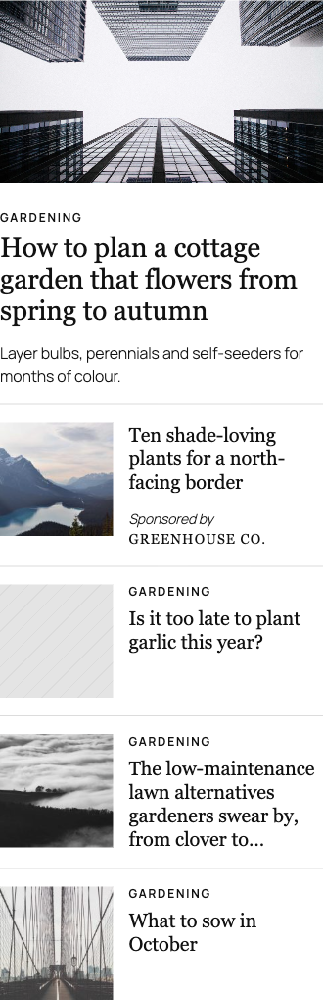

# Latest Articles

A Gutenberg block that shows the newest posts from a chosen category in a magazine-style layout: one large featured article followed by four smaller article cards. Editors pick a category once and the block keeps itself up to date as new posts are published.



| In the editor | On a phone |
|---|---|
|  |  |

The layout follows the [design reference](docs/design-reference.png) supplied with the brief.

## Features

- **Featured article:** the newest post in the category, with a 16:9 image, optional category label, large serif headline and optional excerpt.
- **Card grid:** the following posts in a two-column grid (four by default, a 2 × 2 grid), each with a square thumbnail and a serif headline.
- **Thin dividers** between the featured article and the grid, and between grid rows, with equal space above and below.
- **Responsive:** collapses to one column with smaller thumbnails when the block is narrower than 600px.
- **Editor controls:** category dropdown, "Display category label" toggle, "Show subtext (excerpt)" toggle.
- **Live preview** in the editor that updates as settings change.
- **Sponsored posts (bonus):** a "Sponsorship" field on each post adds "Sponsored by BRAND NAME" to that post's card in the block.
- **Image hover styles (extra):** Default, Zoom on hover or Dim on hover, chosen in the block's Styles panel.

## Requirements

| Software | Version |
|---|---|
| WordPress | 6.8 or later |
| PHP | 7.4 or later (tested on 8.5) |
| Node.js | 20 or later, with npm (only needed to build from source; tested on 26) |

## Installation

### Option A: install the release zip (no build tools needed)

1. Download `latest-articles-block.zip` from the [Releases page](https://github.com/oyic/latest-articles-block/releases).
2. In WordPress, go to **Plugins → Add New Plugin → Upload Plugin**, choose the zip and click **Install Now**.
3. Click **Activate**.

### Option B: build from source

1. Clone the repository into your plugins folder:
   ```bash
   cd wp-content/plugins
   git clone https://github.com/oyic/latest-articles-block.git
   cd latest-articles-block
   ```
2. Install dependencies and build:
   ```bash
   npm install
   npm run build
   ```
3. In WordPress, go to **Plugins** and activate **Latest Articles**.

The compiled `build/` folder isn't committed, so step 2 is required when installing from a clone.

## Usage

1. Edit a page or post and click **+** (Block Inserter).
2. Search for **Latest Articles** and insert it.
3. Choose a category from the dropdown in the block, or from **Category** in the block settings sidebar.
4. Adjust the toggles in the sidebar:
   - **Display category label:** shows the category name above each headline.
   - **Show subtext (excerpt):** shows the excerpt under the featured article's headline.
   - **Number of posts:** how many posts to show, from 1 to 9, including the featured article. Default 5.
5. Optional: open the **Styles** tab in the sidebar to choose an image hover effect.
6. Optional: on the block toolbar, choose **Wide width** or **Full width**.

### Post order

- Posts are ordered by **publish date, newest first**.
- The newest post is the featured article, and the next ones are the cards (four with the default setting of 5).
- Sticky posts are treated like any other post and keep their date order.
- Only published posts are shown. Drafts, scheduled and private posts are skipped.
- When a new post is published in the category, it appears as the featured article automatically. Nobody needs to edit the block.

### Fewer posts and empty categories

- With fewer posts than the chosen number, the block shows only the posts that exist. For example, one post shows just the featured article, with no empty grid.
- If the category has no posts, the editor shows a message and the front end shows nothing.
- If the chosen category is deleted, the editor asks for a new one and the front end shows nothing.
- Posts without a featured image show a neutral striped placeholder of the same size.

### Sponsored posts

1. Edit a post and open the **Post** tab in the sidebar.
2. In the **Sponsorship** panel, type the brand name in **Sponsored by** and save.
3. When that post appears as one of the cards, its category label is replaced by "Sponsored by BRAND NAME" under the headline.

> **Note:** the sponsored label appears on **cards only**, as in the design reference and the brief ("displays 'Sponsored by …' on an article card"). If a sponsored post becomes the newest in its category, it shows as the featured article **without** the label, with its normal category label instead.

Leave the field empty for normal posts.

## Development

### Folder structure

```
latest-articles-block/
├── latest-articles-block.php     Plugin header; registers the block and the sponsor meta
├── src/latest-articles-block/
│   ├── block.json                Block name, attributes, supports, styles, asset files
│   ├── index.js                  Registers the block in the editor
│   ├── edit.js                   Sidebar controls and live preview
│   ├── sponsor-panel.js          "Sponsorship" panel in the post sidebar
│   ├── render.php                Server-side query and markup (front end and preview)
│   ├── style.scss                Layout styles, loaded on the front end and in the editor
│   └── editor.scss               Editor-only styles
├── bin/seed.sh                   WP-CLI script that creates demo content for testing
├── docs/                         Design reference and screenshots
└── build/                        Compiled output (generated, not committed)
```

### Commands

| Command | What it does |
|---|---|
| `npm install` | Installs build tools |
| `npm start` | Builds in development mode and rebuilds on every change |
| `npm run build` | Production build into `build/` |
| `npm run lint:js` / `npm run lint:css` | Checks code against WordPress coding standards |
| `npm run format` | Formats JavaScript with the WordPress Prettier config |
| `npm run plugin-zip` | Creates an installable `latest-articles-block.zip` |

Restart `npm start` after editing `block.json`.

### Demo content

`bin/seed.sh` creates four categories with posts covering every case the block handles: more than five posts, an old sticky post, posts without images, a category with three posts, an empty category and sponsored posts. It also creates a "Block test" page. Run it from a shell where `wp` works for your site (in Local: right-click the site → **Open site shell**):

```bash
bash path/to/latest-articles-block/bin/seed.sh          # create demo content
bash path/to/latest-articles-block/bin/seed.sh --reset  # remove it
```

### Implementation notes and assumptions

- **Dynamic block.** Only the settings are saved in the post. `render.php` queries posts on every page view, which keeps the block current without editor action.
- **One template.** The editor preview uses `ServerSideRender`, so it shows exactly the same markup as the front end.
- **Category label** shows the name of the category selected in the block, since every post shown belongs to it.
- **Excerpt** shows only a hand-written excerpt, trimmed to 25 words. Posts without one show no excerpt.
- **Sponsored label** appears on cards only and replaces the category label, following the design reference.
- **Fonts:** headlines use a system serif stack (Georgia, Times) and other text uses the theme's font. No external fonts are loaded.
- **Responsive layout** uses a CSS container query, so it adapts to the block's own width, not just the screen.

## Known limitations and future improvements

- **Preview speed:** every settings change makes a request to render the preview. A preview built in React would update instantly.
- **Caching:** the query runs on every page view. Caching post IDs in a transient, cleared when posts are published or updated, would reduce database load.
- **Duplicate posts:** two blocks for the same category on one page show the same posts. A "skip posts shown above" option would fix this.
- **Sponsored featured article:** a sponsored post in the featured position isn't labelled as sponsored. Most advertising rules require sponsored content to be disclosed wherever it appears, so a production version should show the label on the featured article too. It's a small change in `render.php` that reuses the card's markup and styles.
- **Meta key:** `sponsored_by` isn't prefixed; a prefixed key such as `oyic_sponsored_by` would avoid clashes with other plugins.
- **Tests:** testing is manual against the demo content. PHPUnit tests for `render.php` and a Playwright end-to-end test would be the next step.

## Use of AI tools

<!--
TODO: Review and complete this section yourself. The guidelines require
an accurate account, so edit the list below to match what really happened,
and fill in "What I changed".
-->

**Tool used:** Claude Code (Anthropic), in the terminal.

**What I used it for:**

- Turning the brief into a task plan, and reading the layout specs out of the design reference image.
- Drafting code that I then reviewed, pasted and committed step by step: block attributes, sidebar controls, `render.php`, styles, sponsor meta and panel, hover styles.
- Writing and debugging the `bin/seed.sh` demo-content script.
- Diagnosing problems: a PHP parse error, spaces instead of tabs, a misplaced `styles` key in `block.json`.
- Drafting this README and a study guide for the code review.

**What I changed or decided myself:**

- TODO: list the changes you made to generated code, and the decisions you made (for example: which preview approach, the label behaviour, adding hover styles).

## License

GPL-2.0-or-later
